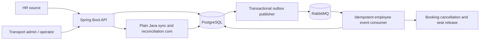

# HR Roster Sync — design

## Requirements and assumptions

This service accepts versioned HR events and nightly CSV rosters for multiple
tenants. It preserves transport-owned preferences, rejects invalid rows without
leaking personal data, and prevents incomplete or suspicious snapshots from
deactivating employees. A PostgreSQL transaction is the authority for employee
version checks and outbox writes. RabbitMQ carries downstream events; delivery
is at-least-once and consumers deduplicate. A snapshot of 200,000 employees
must be streamed with bounded application memory and benchmarked against the
60-second target. When missing active employees reach the configured 30%
threshold, an operator must approve or reject the run before any changes apply.

Assumptions taken from the prompt:

- `sourceVersion` is a non-negative, monotonically increasing integer per
  employee. Each employee is bound to one authoritative HR source system so
  versions from different sources are never compared. An event contains the
  complete HR-owned state.
- HR owns name, email, phone, manager, office, shift and employment status.
  Transport administrators own pickup point and special-assistance needs.
- HR payloads containing transport-owned fields are rejected, not silently
  accepted. Tenant identity comes from the authenticated credential.
- Snapshot CSVs use a header row and the same complete-state and version
  semantics as events. A snapshot cutoff prevents deactivating employees
  created after the export began; rows changed after that cutoff are protected
  from absence-based deactivation. A snapshot absence deactivation advances
  the employee's source version by one.
- JWTs are used for application roles; HR source credentials are tenant-bound.
  Demo credentials are local-development fixtures only.
- An invalid snapshot row protects the matching employee from absence-based
  deactivation. Partial field updates, Kubernetes, microservices, Redis and a
  production UI are deliberately out of scope.

## Architecture



The application is a modular monolith. Controllers translate HTTP requests and
responses; services own use cases and transaction boundaries; repositories
scope every read and write by tenant. Version comparison, fingerprinting,
ownership checks, diff classification and safety-brake calculations are plain
Java classes so they can be tested without Spring or a database.

## Data model and API

`employees` has composite primary key `(tenant_id, employee_id)`, HR-owned
columns, transport-owned columns, `hr_version`, and a canonical HR fingerprint.
`hr_event_inbox` has a unique key on tenant, source, employee and source version.
`outbox_events` is inserted in the employee transaction. Snapshot runs,
staging rows, row errors, approval audit entries, offices, bookings, seats and
processed message IDs are persisted in PostgreSQL. Staging and all operational
queries include tenant and run identifiers.

| Endpoint | Purpose |
|---|---|
| `POST /api/v1/hr/events` | Validate and process one event or a batch, returning one result per record. |
| `POST /api/v1/hr/snapshots` | Stream a CSV upload into a persisted reconciliation run. |
| `GET /api/v1/hr/snapshots/{runId}` | Read run state and aggregate diff counts. |
| `GET /api/v1/hr/snapshots/{runId}/errors` | Read row-level error codes without personal data. |
| `POST /api/v1/hr/snapshots/{runId}/approve` | Operator approval of a safety-braked run. |
| `POST /api/v1/hr/snapshots/{runId}/reject` | Operator rejection with an audited reason. |
| `GET /api/v1/employees/{employeeId}` | Read an employee allowed by role and tenant policy. |
| `PUT /api/v1/employees/{employeeId}/transport-preferences` | Update transport-owned fields without changing the HR version. |
| `/api/v1/admin/offices` | Manage tenant-scoped office master data. |
| `/actuator/prometheus` | Export operational metrics. |

## Consistency, failure recovery and diagrams

```mermaid
sequenceDiagram
    participant Operator
    participant Snapshot as Snapshot service
    participant DB as PostgreSQL
    participant HR as Live event service
    participant Publisher as Outbox publisher
    participant Broker as RabbitMQ
    participant Consumer as Booking consumer

    Operator->>Snapshot: Upload complete CSV
    Snapshot->>DB: Stage rows and classify diff
    HR->>DB: Lock employee; apply newer version and insert outbox
    Operator->>Snapshot: Approve run if safety brake fired
    Snapshot->>DB: Apply through shared version-checked sync engine
    DB-->>Snapshot: Older snapshot versions are stale
    Snapshot->>DB: Deactivate only eligible missing employees + outbox
    Publisher->>DB: Claim pending events (SKIP LOCKED)
    Publisher->>Broker: Publish with confirmation
    Broker->>Consumer: Deliver (may be repeated)
    Consumer->>DB: Deduplicate and cancel future bookings atomically
```

| Trade-off | Choice |
|---|---|
| Consistency / availability / latency | Row-locked version checks give strong per-employee consistency. The outbox makes downstream effects eventual. The safety brake pauses a risky nightly run rather than maximizing availability. Snapshot processing is asynchronous to keep upload acknowledgement responsive. |
| Delivery semantics | At-least-once outbox delivery; consumers use a processed-message ledger rather than claiming exactly-once delivery. |
| Deployment shape | A modular monolith keeps transactions local and deployment simple; modules can be separated only if measured operational needs justify it. |
| Snapshot diff | PostgreSQL staging and indexed set-based joins trade disk and database work for bounded JVM memory. |
| Ownership conflicts | Rejecting transport-owned fields in HR payloads makes ownership mistakes visible while preserving admin data. |

Hardest flow: the sequence diagram above shows a nightly snapshot being applied while live HR events
for the same employees keep arriving, with an operator decision in the middle and at-least-once delivery
afterwards. Every employee write, from either path, takes the same per-employee advisory lock and the same
version check, so whichever commits first is never overwritten by an older version.

Failure modes (T = automated test; all live in `src/test/java/com/moveinsync/roster/`):

| What fails | What the user sees | How the system recovers | Test |
|---|---|---|---|
| App crashes after DB commit, before publish | Downstream update is delayed | Publisher resumes pending outbox rows after restart | `RosterIntegrationTest.committedOutboxEventCanBePublishedAfterTheOriginalRequestReturns` |
| Crash after broker acknowledgement | A message can be delivered twice | Consumer deduplicates by message ID | `RosterIntegrationTest.duplicateDeactivationDeliveryReleasesASeatOnlyOnce`, `AdvancedGuaranteesIntegrationTest.duplicateDeliveriesRacingReleaseTheSeatAndWriteTheLedgerOnce` |
| RabbitMQ unavailable | Pending events accumulate; alert fires | Retry with exponential backoff, drain after recovery | `AdvancedGuaranteesIntegrationTest.brokerOutageKeepsEventsPendingWithBackoffAndTheyDrainAfterRecovery` |
| Consumer fails mid-cancellation | No partial cancellation is visible | Transaction rolls back, ledger row is rolled back too, redelivery completes the work | `AdvancedGuaranteesIntegrationTest.failureMidCancellationRollsBackTheLedgerSoRedeliveryCompletesTheWork` |
| Truncated nightly export | Run requests operator decision with aggregate counts | Approve or reject; no deactivation before approval | `SafetyBrakeTest`, `RosterIntegrationTest.truncatedSnapshotWaitsForAnAuditedOperatorDecision` |
| Upload interrupted | Run is marked FAILED; nothing applied | Upload again; the failed run is retained for audit | `AdvancedGuaranteesIntegrationTest.uploadInterruptedMidStreamFailsTheRunAndAppliesNothing` |
| Row count / checksum mismatch | Run FAILED, nothing applied | HR resends the correct file | `RosterIntegrationTest.manifestMismatchLeavesTheRunFailedAndAppliesNothing` |
| Invalid row | Per-record rejection or row error | Other valid records continue; HR corrects and resends | `HrEventServiceTest`, `RosterIntegrationTest.invalidSnapshotRowProtectsTheMatchingEmployeeFromDeactivation` |
| Concurrent conflicting versions | Higher version wins | Advisory lock plus version re-check inside the transaction | `RosterIntegrationTest.higherVersionWinsWhenRequestsArriveConcurrently`, `AdvancedGuaranteesIntegrationTest.versionsRacingInAnyOrderAlwaysLeaveTheHighestVersionAndOneOutboxRowPerApply` |
| Same event sent many times at once | One APPLIED, the rest DUPLICATE | Per-employee lock serialises them | `AdvancedGuaranteesIntegrationTest.identicalEventsRacingProduceExactlyOneApplyAndOneOutboxRow` |
| Process dies mid-apply | Run remains resumable | Startup re-enters the idempotent sync engine | `RosterIntegrationTest.applyingRunResumesAfterACommittedBatchWasInterrupted` |
| Wrong tenant / role / token | 401 or 403 with a generic error code | Request never reaches the service layer | `AuthorizationMatrixTest`, `SecurityAccessTest` |

## Complexity and scale limits

| Operation | Time | Space |
|---|---|---|
| Single event | O(1) indexed lookups plus transaction/lock wait | O(1) application memory |
| CSV parsing and validation | O(N) | O(batch size) application memory |
| Staging load | O(N) database writes | O(N) database disk |
| Indexed staging diff | O(N) expected with indexed joins | O(batch size) application memory; database owns sort/hash work |
| Outbox publisher | O(P) for P pending rows | O(claim batch size) |
| Bounded cache | O(1) typical lookup | O(maximum configured entries) |

The real scaling limit is intentionally not claimed in advance. The benchmark
must record the observed PostgreSQL write throughput, row-lock contention,
publisher throughput, staging/index size, JVM heap and hardware. Results belong
in the README only after the benchmark is run on the stated machine.
